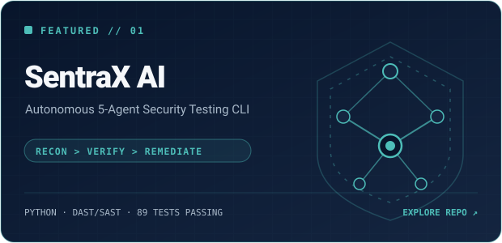
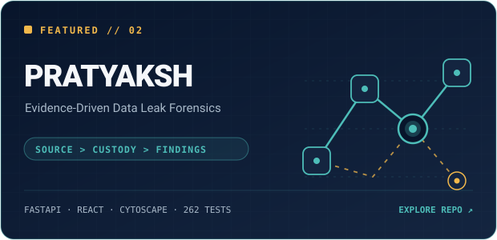

<div align="center">
  
  <br /><br />
  <a href="https://github.com/Tanish18906"></a>
  &nbsp;
  <a href="https://www.linkedin.com/in/tanish-mishra-392383263"></a>
  &nbsp;
  <a href="https://www.fiverr.com/tanish_mishra"></a>
  &nbsp;
  <a href="mailto:tanish18906@gmail.com"></a>
  &nbsp;
  <a href="https://github.com/Tanish18906?tab=repositories"></a>
</div>

<br />

## 01 // About Me

I build software that bridges the gap between **autonomous AI models, production automation pipelines, and deterministic verification**. Based in **Raipur, India**, I am a Computer Science Engineering student focused on building intelligent systems that go beyond superficial text generation to take reliable, observable action.

My engineering focus centers on **multi-agent architectures, forensic security tooling, and applied business automation**. Beyond the terminal, I channel an obsession with atmospheric world-building into **interactive storytelling and game development**—bringing the same discipline for systems architecture to immersive creative experiences.

```yaml
developer:
  name: Tanish Mishra
  location: Raipur, India
  discipline: AI Engineering · Automation Architect · Creative Developer
  education: Computer Science Engineering
  interests: [Multi-Agent Systems, Security Engineering, LLM Orchestration, Game Dev]
  ambition: Build enduring software products & original narrative-driven games
  credo: "Ground assertions in evidence; build systems that hold up under real-world pressure."
```

---

## 02 // Featured Projects

<div align="center">
  <a href="https://github.com/Tanish18906/SentraX"></a>
  <a href="https://github.com/Tanish18906/PRATYAKSH"></a>
</div>

<br />

| Project | Focus & Architecture | Core Stack | Repository |
| :--- | :--- | :--- | :--- |
| **[SentraX AI ↗](https://github.com/Tanish18906/SentraX)** | Autonomous 5-agent security testing CLI coordinating `Recon`, `Strategist`, `Exploit`, `Remediation`, and `Reporter` agents. Features deterministic confirmation rules for SQLi, XSS, and IDOR with comprehensive executive reporting. | `Python` `Pydantic` `Rich` `Pytest (89 tests)` `DAST/SAST` | [`Tanish18906/SentraX`](https://github.com/Tanish18906/SentraX) |
| **[PRATYAKSH ↗](https://github.com/Tanish18906/PRATYAKSH)** | Evidence-driven data leak investigation platform built for INNOVATHON 2026. Employs HMAC MinHash file fingerprinting, custody graph traversal, ranked route analysis, and privacy-preserving audit logs. | `FastAPI` `React` `TypeScript` `Cytoscape.js` `Tailwind CSS` | [`Tanish18906/PRATYAKSH`](https://github.com/Tanish18906/PRATYAKSH) |

<br />

<details>
<summary><b>🧪 In the Lab &amp; Explorations</b></summary>
<br />

- **Bharat Lens** — Voice-first multi-lingual assistant engineered to help citizens discover and navigate relevant Indian government welfare schemes using semantic retrieval and RAG. *(Private prototype)*
- **ZerothAI** — Applied AI workflow engineering and multi-agent business automation pipelines designed for operational leverage.
- **AI Email Automation** — Production orchestration workflow for contextual intent classification, intelligent draft generation, and human-in-the-loop review routing. *(Built with n8n, OpenAI API & Webhooks)*
- **Sentinel** — Cloud traffic anomaly and DDoS pattern identification system. *(CS/IT Finalist, Vigyaan 2026 at NIT Raipur)*

</details>

---

## 03 // Tech Arsenal

<table>
  <tr>
    <td width="22%"><b>Languages</b></td>
    <td><a href="https://skillicons.dev"></a></td>
  </tr>
  <tr>
    <td width="22%"><b>AI &amp; Automation</b></td>
    <td><a href="https://skillicons.dev"></a> &nbsp; <code>LLM APIs</code> · <code>n8n</code> · <code>LangChain</code> · <code>RAG</code> · <code>Multi-Agent Systems</code></td>
  </tr>
  <tr>
    <td width="22%"><b>Frontend</b></td>
    <td><a href="https://skillicons.dev"></a></td>
  </tr>
  <tr>
    <td width="22%"><b>Backend &amp; Databases</b></td>
    <td><a href="https://skillicons.dev"></a></td>
  </tr>
  <tr>
    <td width="22%"><b>Tools &amp; Creative</b></td>
    <td><a href="https://skillicons.dev"></a></td>
  </tr>
</table>

---

## 04 // Current Focus

```bash
~/tanish $ cat current_focus.json
{
  "active_pursuits": [
    "Architecting autonomous, deterministic multi-agent systems",
    "Developing end-to-end AI automation workflows with human-in-the-loop validation",
    "Evidence-driven security tooling & vulnerability research engines",
    "Refining distributed system test coverage and CI reliability",
    "Prototyping narrative-driven world mechanics in Unity"
  ],
  "engineering_ethos": "Prefer working systems over speculation; verify before concluding."
}
```

---

## 05 // GitHub Activity

<div align="center">
  
  &nbsp;
  
</div>

---

## 06 // Beyond the Terminal

Beyond systems engineering and agentic workflows, I care deeply about **interactive storytelling and game development**. 

Narrative masterpieces like *Red Dead Redemption 2*, *The Last of Us*, and *Uncharted* define the kind of software experiences I admire most: immersive, character-driven worlds where environmental details, pacing, and emotional resonance matter just as much as resilient systems underneath. Whether modeling assets in Blender, scripting mechanics in Unity, or engineering complex backend pipelines, the standard remains identical—**deliberate craft in every detail**.

---

<div align="center">

### Good ideas are common. Working systems are rare.

Whether you are exploring agentic architectures, automation pipelines, or creative collaborations—let's build something real.

<br />

<a href="https://www.linkedin.com/in/tanish-mishra-392383263"></a>
&nbsp;
<a href="https://www.fiverr.com/tanish_mishra"></a>
&nbsp;
<a href="mailto:tanish18906@gmail.com"></a>
&nbsp;
<a href="https://github.com/Tanish18906"></a>

<br /><br />

<sub>Designed with precision · Raipur, India · © 2026 Tanish Mishra</sub>

</div>
