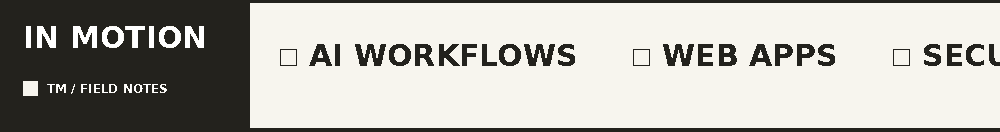

<!-- GitHub profile | Tanish Mishra | Cream / Ink / Yellow -->

<!-- Original portfolio header, preserved. -->

  

  

    <a href="#selected-work"><b>Selected work</b></a> &nbsp; / &nbsp;
    <a href="#toolbox"><b>Toolbox</b></a> &nbsp; / &nbsp;
    <a href="#github-activity"><b>Activity</b></a> &nbsp; / &nbsp;
    <a href="#on-my-desk"><b>On my desk</b></a> &nbsp; / &nbsp;
    <a href="#lets-talk"><b>Contact</b></a>
  

<!-- Animation 01 / Typing, customized to the portfolio palette. -->

  

  I'm Tanish, a second-year CSE student from Raipur. 
  I build tools for real problems, learn by breaking things, and keep a few ambitious ideas on the side.

  <a href="https://www.tanishmishra.tech"><b>Portfolio</b></a> &nbsp; · &nbsp;
  <a href="https://www.tanishmishra.tech/work"><b>Case studies</b></a> &nbsp; · &nbsp;
  <a href="https://www.linkedin.com/in/tanish-mishra-392383263"><b>LinkedIn</b></a>

<!-- Animation 02 / Local GIF stays animated without third-party services. -->

<h2 id="selected-work">01 / Selected work</h2>

<!-- Native GitHub table cards, no JavaScript required. -->
<table>
  <tr>
    <td width="50%" valign="top">
      <code>01 · CLIENT PROTOTYPE</code>
      <h3><a href="https://www.tanishmishra.tech/work/sop-opera">Foreman ↗</a></h3>
      
From messy inbox messages to organized requests, draft replies, and human approval.

      
<code>Next.js</code> &nbsp;<code>n8n</code> &nbsp;<code>Supabase</code>

      
<a href="https://github.com/Tanish18906/Project-Saint-Builder"><b>Code</b></a> &nbsp;·&nbsp; <a href="https://allsaintsbuilders.vercel.app/login"><b>Prototype</b></a>

    </td>
    <td width="50%" valign="top">
      <code>02 · CLIENT WORK</code>
      <h3><a href="https://www.tanishmishra.tech/work/flowsync">Ridley Academy ↗</a></h3>
      
A support-email workflow with knowledge-base answers and a handoff when a person is needed.

      
<code>n8n</code> &nbsp;<code>RAG</code> &nbsp;<code>Pinecone</code>

      
<a href="https://www.tanishmishra.tech/work/flowsync"><b>Case study</b></a>

    </td>
  </tr>
  <tr>
    <td width="50%" valign="top">
      <code>03 · SECURITY TOOL</code>
      <h3><a href="https://github.com/Tanish18906/SentraX">SentraX AI ↗</a></h3>
      
A Python CLI for finding security issues and separating evidence from assumptions.

      
<code>Python</code> &nbsp;<code>Pydantic</code> &nbsp;<code>Pytest</code>

      
<a href="https://github.com/Tanish18906/SentraX"><b>Source code</b></a>

    </td>
    <td width="50%" valign="top">
      <code>04 · HACKATHON BUILD</code>
      <h3><a href="https://github.com/Tanish18906/PRATYAKSH">PRATYAKSH ↗</a></h3>
      
A simulated data-leak investigation using file fingerprints and incomplete logs.

      
<code>FastAPI</code> &nbsp;<code>React</code> &nbsp;<code>TypeScript</code>

      
<a href="https://github.com/Tanish18906/PRATYAKSH"><b>Source code</b></a> &nbsp;·&nbsp; <a href="https://pratyaksh-frontend.netlify.app"><b>Demo</b></a>

    </td>
  </tr>
</table>

  
<b>A closer look at the work</b> &nbsp; <small><em>(click to expand)</em></small>

  
<b>Foreman</b> is a working prototype with sample data and manual email triggers. Direct IMAP/SMTP integration is not part of the current demo.

  
<b>Ridley Academy</b> explores support automation where human escalation still matters.

  
<b>SentraX</b> and <b>PRATYAKSH</b> are security-focused experiments, not claims of production-grade protection.

  
<a href="https://www.tanishmishra.tech/work">Explore the project write-ups ↗</a>

<h2 id="toolbox">02 / Tools I reach for</h2>

  

<small><em>Also in the mix: n8n, REST APIs, RAG workflows, and a lot of terminal tabs.</em></small>

<h2 id="github-activity">03 / GitHub activity</h2>

<!-- Dynamic public contribution graph. -->

<small><em>What I've been making, fixing, and learning on GitHub.</em></small>

<h2 id="on-my-desk">04 / Currently</h2>

| NOW | NEXT | LONG GAME |
| :--- | :--- | :--- |
| Starting a small AI services agency | Sharing more of the work in public | Designing story-driven games |

  
<b>Outside the editor</b> &nbsp; <small><em>(click to expand)</em></small>

  
I love story-mode games and the details that make a world feel alive. Games like Red Dead Redemption 2, The Last of Us, and Uncharted are part of why I want to make my own someday.

<!-- Original final contact banner, preserved. -->
## Let's talk

  <a href="https://www.tanishmishra.tech"><b>Portfolio</b></a> &nbsp; / &nbsp;
  <a href="https://www.linkedin.com/in/tanish-mishra-392383263"><b>LinkedIn</b></a> &nbsp; / &nbsp;
  <a href="mailto:tanish18906@gmail.com"><b>Email</b></a>

