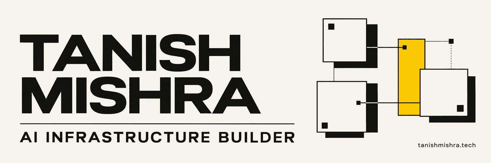
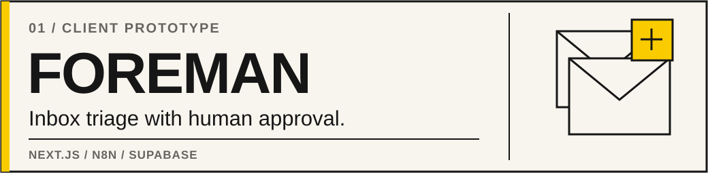
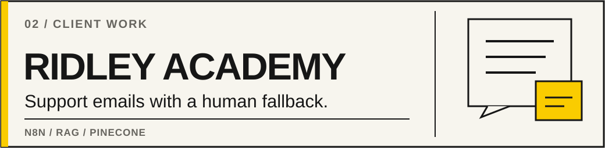
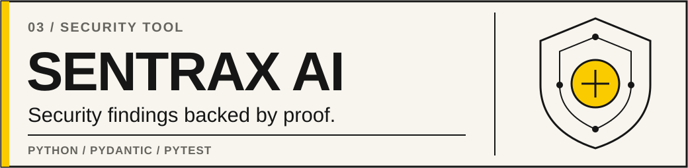
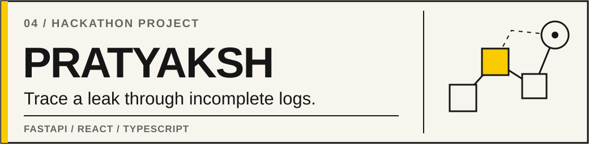
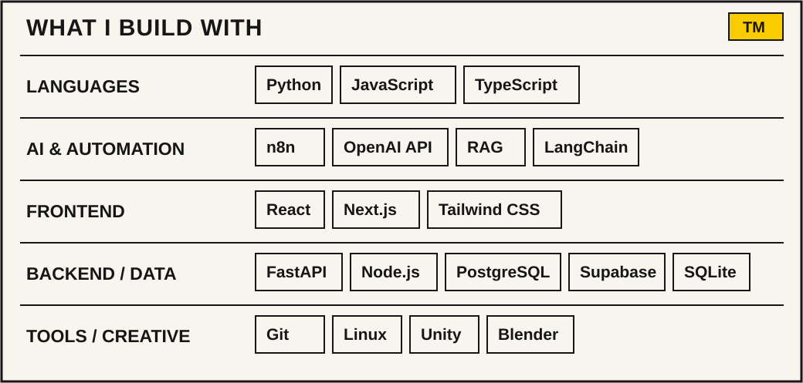
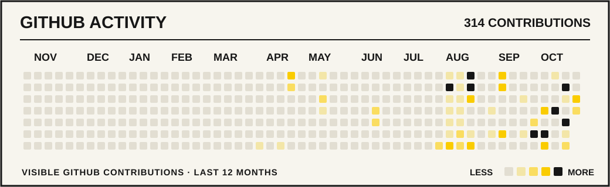
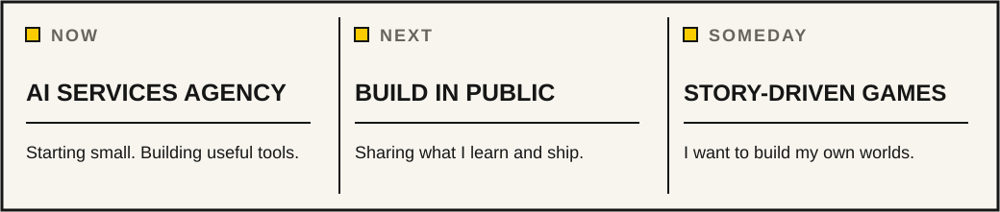

<!-- Tanish Mishra | Portfolio-aligned GitHub profile -->

  

  

    <a href="#selected-work">Selected work</a> &nbsp; / &nbsp;
    <a href="#toolbox">Toolbox</a> &nbsp; / &nbsp;
    <a href="#github-activity">Activity</a> &nbsp; / &nbsp;
    <a href="#on-my-desk">On my desk</a> &nbsp; / &nbsp;
    <a href="#lets-talk">Contact</a>
  

  I'm Tanish, a second-year CSE student from Raipur. I build practical AI workflows, web apps, and security tools.
  Some are for clients. Others start with a question I can't stop thinking about.

## Selected work

  
<b>Open Foreman details</b> &nbsp; | &nbsp; Prototype · Workflow · Demo

  An interactive prototype for a UK construction team handling messages from two inboxes. It organizes requests, prepares replies, and keeps staff in control of approval. The demo uses sample data and manual email triggers; direct inbox integration was not completed.

  **Next.js · TypeScript · n8n · Supabase · OpenAI**

  [Case study](https://www.tanishmishra.tech/work/sop-opera) · [Source code](https://github.com/Tanish18906/Project-Saint-Builder) · [Prototype](https://allsaintsbuilders.vercel.app/login)

  
<b>Open Ridley Academy details</b> &nbsp; | &nbsp; Client work · Support automation

  A support email workflow for an online piano-learning platform. It uses a knowledge base to help with routine questions and hands sensitive cases to a person.

  **n8n · OpenAI · Pinecone · Gmail · Slack**

  [Case study](https://www.tanishmishra.tech/work/flowsync)

  
<b>Open SentraX details</b> &nbsp; | &nbsp; Security · Python CLI

  A security testing CLI with five focused agents. It checks selected vulnerabilities, separates confirmed findings from guesses, and shows what needs fixing.

  **Python · Pydantic · Rich · Pytest**

  [Case study](https://www.tanishmishra.tech/work/konta) · [Source code](https://github.com/Tanish18906/SentraX)

  
<b>Open PRATYAKSH details</b> &nbsp; | &nbsp; Hackathon · Digital forensics

  A simulated data-leak investigation tool. It matches file fingerprints, traces possible paths through incomplete logs, and makes the missing evidence visible.

  **FastAPI · Python · React · TypeScript**

  [Case study](https://www.tanishmishra.tech/work/gina) · [Source code](https://github.com/Tanish18906/PRATYAKSH) · [Demo](https://pratyaksh-frontend.netlify.app)

  <a href="https://www.tanishmishra.tech/work"><b>See all project write-ups →</b></a>

  
<b>More experiments from my GitHub</b>

  - [ReviewLens](https://github.com/Tanish18906/ReviewLens): a student review platform exploring sentiment and review credibility.
  - [Python Learning](https://github.com/Tanish18906/Python-Learning): exercises and experiments from learning Python.

## Toolbox

  
<b>How I usually put these tools together</b>

  **Frontend → API → database → automation → human review.**

  I like tools that are easy to understand and change when requirements shift. The stack depends on the problem, not the other way around.

  Text version of the toolbox for smaller screens:

  - **Languages:** Python, JavaScript, TypeScript
  - **AI & automation:** n8n, OpenAI API, RAG, LangChain
  - **Frontend:** React, Next.js, Tailwind CSS
  - **Backend & data:** FastAPI, Node.js, PostgreSQL, Supabase, SQLite
  - **Tools & creative:** Git, Linux, Unity, Blender

## GitHub activity

  Public contributions · Updated weekly through GitHub Actions

## On my desk

  
<b>And when I'm not coding?</b>

  I'm into story-driven games, interactive interfaces, and small experiments. *Red Dead Redemption 2*, *The Last of Us*, and *Uncharted* are the games that made me want to create worlds of my own someday.

## Let's talk

  <a href="https://www.tanishmishra.tech"><b>Portfolio</b></a> &nbsp; / &nbsp;
  <a href="https://www.linkedin.com/in/tanish-mishra-392383263"><b>LinkedIn</b></a> &nbsp; / &nbsp;
  <a href="mailto:tanish18906@gmail.com"><b>Email</b></a>

Designed with a little help from late nights and too many open tabs.

