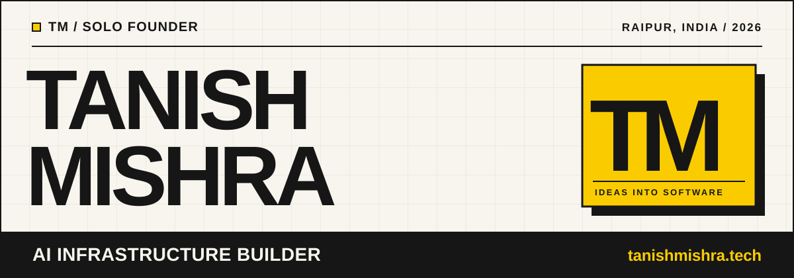

  <picture>
    <source media="(prefers-color-scheme: dark)" srcset="./assets/header-tokyo-night.svg" />
    <source media="(prefers-color-scheme: light)" srcset="./assets/header-cream.svg" />
    
  </picture>

  <a href="https://www.tanishmishra.tech">Portfolio</a>
  &nbsp; / &nbsp;
  <a href="https://www.tanishmishra.tech/work">Selected work</a>
  &nbsp; / &nbsp;
  <a href="https://www.linkedin.com/in/tanish-mishra-392383263">LinkedIn</a>
  &nbsp; / &nbsp;
  <a href="mailto:tanish18906@gmail.com">Email</a>

## 01 / A little about me

I build software that takes the busywork off your plate.

I'm **Tanish**, a second-year CSE student from Raipur, India. I like starting projects that are a little beyond what I already know how to build. Lately, that has meant AI automations, web apps, and security tools.

I also do freelance work for businesses, mostly connecting APIs, organizing information, and building workflows that people can actually use. The best part is when a rough idea finally works outside my own laptop.

## 02 / Four things worth opening

<table>
  <tr>
    <td width="50%" valign="top">
      01 / CLIENT WORK
      <h3>Foreman</h3>
      
An inbox prototype for a UK construction team. Sorts messages, drafts replies, and gives staff a clear approval step. The demo runs on sample data, with manual email triggers.

      
<code>Next.js</code> <code>n8n</code> <code>Supabase</code> <code>OpenAI</code>

      <a href="https://www.tanishmishra.tech/work/sop-opera">Case study</a> · <a href="https://github.com/Tanish18906/Project-Saint-Builder">Code</a>
    </td>
    <td width="50%" valign="top">
      02 / CLIENT WORK
      <h3>Ridley Academy</h3>
      
An email support workflow for an online piano-learning platform. Uses a knowledge base to prepare routine replies and sends sensitive cases to a person.

      
<code>n8n</code> <code>OpenAI</code> <code>Pinecone</code> <code>Gmail</code>

      <a href="https://www.tanishmishra.tech/work/flowsync">Case study</a>
    </td>
  </tr>
  <tr>
    <td width="50%" valign="top">
      03 / SECURITY TOOL
      <h3>SentraX AI</h3>
      
A five-agent security CLI that tests selected web vulnerabilities, checks the evidence, and shows what needs fixing.

      
<code>Python</code> <code>Rich</code> <code>Pydantic</code> <code>Pytest</code>

      <a href="https://www.tanishmishra.tech/work/konta">Case study</a> · <a href="https://github.com/Tanish18906/SentraX">Code</a>
    </td>
    <td width="50%" valign="top">
      04 / HACKATHON
      <h3>PRATYAKSH</h3>
      
A simulated data-leak investigation tool. Matches file fingerprints, maps possible routes, and makes missing evidence visible.

      
<code>FastAPI</code> <code>React</code> <code>TypeScript</code> <code>Python</code>

      <a href="https://www.tanishmishra.tech/work/gina">Case study</a> · <a href="https://github.com/Tanish18906/PRATYAKSH">Code</a>
    </td>
  </tr>
</table>

<a href="https://www.tanishmishra.tech/work">See all project write-ups →</a>

## 03 / What I build with

| | Tools I reach for |
| :--- | :--- |
| **Languages** | Python, JavaScript, TypeScript |
| **AI & automation** | n8n, OpenAI API, RAG, LangChain |
| **Frontend** | React, Next.js, Tailwind CSS |
| **Backend** | FastAPI, Node.js, Express, REST APIs |
| **Data** | PostgreSQL, SQLite, Supabase |
| **Other tools** | Git, GitHub, Linux, Unity, Blender |

## 04 / In the works

- Building toward my own AI services agency, with a focus on practical automation and infrastructure for businesses.
- Getting better at taking a product from the first sketch to something people can use.
- Learning more about game design. I want to make my own story-driven game someday.

Outside of coding, I love games like *Red Dead Redemption 2*, *The Last of Us*, and *Uncharted*. The writing, pacing, and little world details are a big part of why I want to build games of my own.

## 05 / Have something you want to build?

Tell me about it. I'm always interested in a good problem, whether it's a business workflow or a strange little side project.

**[tanishmishra.tech](https://www.tanishmishra.tech)** &nbsp; / &nbsp; **[LinkedIn](https://www.linkedin.com/in/tanish-mishra-392383263)** &nbsp; / &nbsp; **[Email me](mailto:tanish18906@gmail.com)**

Made by Tanish in Raipur, India. Thanks for stopping by.

